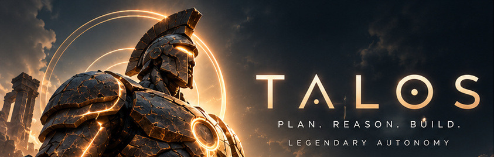
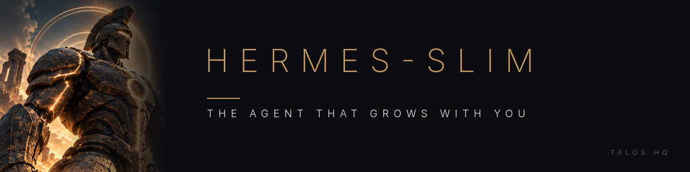
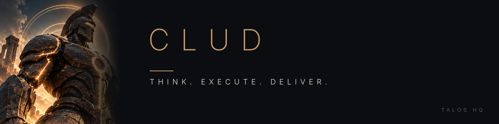
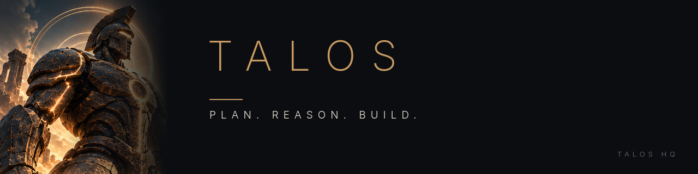
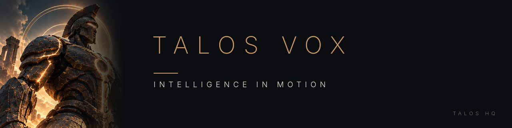
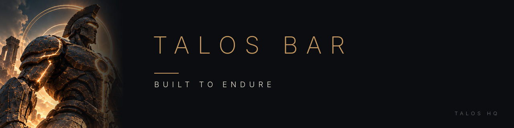

<div align="center">

<a href="https://talosbot.ai"></a>

<br>

<a href="https://talosbot.ai"></a>
<a href="https://talosbot.ai/install/"></a>
<a href="https://github.com/orgs/talos-hq/repositories"></a>

### Plan. Reason. Build.

*Think. Execute. Deliver. · Intelligence in Motion · Built to Endure*

</div>

---

**Talos HQ builds agents you can leave running.** Our agent is [Hermes Agent](https://github.com/NousResearch/hermes-agent) from Nous Research with our fixes built in to the installer, the state store and the gateway, and with upstream merged in continually. Around it we build the tools we work with every day: a coding CLI that runs Claude, Codex and DeepSeek on the Claude Code harness, voice dictation for Wayland, and a desktop bar that agents extend in plain Python.

> In the myth, Talos was the bronze guardian of Crete, a machine that never tired. We picked the name for an agent you can leave running.

## From the forge

<table>
<tr>
<td width="50%" valign="top">
<a href="https://github.com/talos-hq/hermes-slim"></a>
<br><b><a href="https://github.com/talos-hq/hermes-slim">hermes-slim</a></b> — The agent that grows with you. Our fork of Hermes Agent, with our fixes on top and upstream merged in.
</td>
<td width="50%" valign="top">
<a href="https://github.com/talos-hq/clud"></a>
<br><b><a href="https://github.com/talos-hq/clud">clud</a></b> — Claude &amp; Codex CLI with safety 3rd and God Mode always. Runs Claude, Codex and DeepSeek on the Claude Code harness, and takes an issue all the way to a merged PR.
</td>
</tr>
<tr>
<td width="50%" valign="top">
<a href="https://github.com/talos-hq/talos"></a>
<br><b><a href="https://github.com/talos-hq/talos">talos</a></b> — Hermes Agent with our fixes built in, and the home of the signed one-line installer for Linux, macOS and Windows (in progress — no release yet).
</td>
<td width="50%" valign="top">
<a href="https://github.com/talos-hq/talos-vox"></a>
<br><b><a href="https://github.com/talos-hq/talos-vox">talos-vox</a></b> — Push-to-talk voice-to-text for Wayland compositors, local by default. Our fork of <a href="https://github.com/peteonrails/voxtype">Voxtype</a>.
</td>
</tr>
<tr>
<td width="50%" valign="top">
<a href="https://github.com/talos-hq/talos-bar"></a>
<br><b><a href="https://github.com/talos-hq/talos-bar">talos-bar</a></b> — A cross-platform desktop bar in PySide6 + QML. Agents add bar items by dropping a Python file in <code>glue/</code>, with hot reload. Design phase.
</td>
<td width="50%" valign="top">
<b>Also in the forge</b>
<br><br>
<b><a href="https://github.com/talos-hq/client-skills">client-skills</a></b> — Client-facing Hermes Agent skills: installable, versioned, and gated before they ship.
<br><br>
<b><a href="https://github.com/talos-hq/talos-calendar">talos-calendar</a></b> — Slot computation, time zone helpers and a dependency-free slot picker for booking pages.
<br><br>
<b><a href="https://github.com/talos-hq/hermes-agent-self-evolution">hermes-agent-self-evolution</a></b> — Our fork of the DSPy + GEPA toolkit that evolves Hermes Agent skills, prompts and code.
<br><br>
<b><a href="https://github.com/talos-hq/talos-hq.github.io">talos-hq.github.io</a></b> — Source of <a href="https://talosbot.ai">talosbot.ai</a>.
</td>
</tr>
</table>

## Get started

**The agent** — run our Hermes fork from source. `source ./activate` sets up a pinned uv, Python 3.14 and the locked dependencies, then puts `hermes` on your PATH inside the checkout.

```bash
git clone https://github.com/talos-hq/hermes-slim && cd hermes-slim && source ./activate
```

**clud** — installs `uv` if needed, then `uv tool install clud`.

```bash
curl -fsSL https://raw.githubusercontent.com/talos-hq/clud/main/install.sh | sh
```

Every command, with what it does and how to pin a version: **[talosbot.ai/install](https://talosbot.ai/install/)**.

<div align="center">

<br>

<a href="https://talosbot.ai"></a>

<sub><b>TALOS</b> · A higher class of agents · Built on Hermes Agent · <a href="https://talosbot.ai">talosbot.ai</a></sub>

</div>
